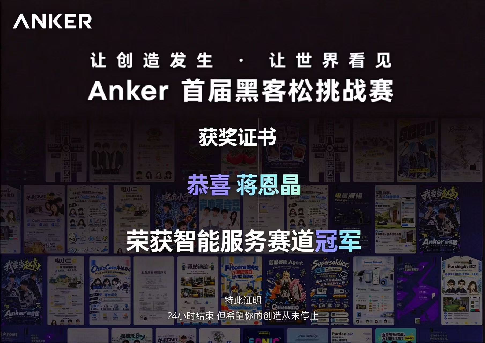

[中文](README.zh-CN.md)

# Hi, I'm Enjing Jiang

**Master's student at Tsinghua SIGS · AI products & Agent applications · Shenzhen**

I turn business problems into AI workflows that people can try, inspect, and evaluate. My recent projects span customer support, returns decisions, and learning automation. My research focuses on time-series foundation models, demand forecasting, and optimization.

**Open to AI product / Agent internships.** My background in Industrial Engineering, Logistics Engineering and Management, and overseas GTM connects user needs with product design, business constraints, and delivery.

[Xiaohongshu](https://xhslink.cn/o/Aym0oPhPO59) · [Personal introduction](https://jiangenjing.github.io/enjing-interview-portfolio/) · [Dreame internship portfolio](https://jiangenjing.github.io/dreame-gtm-portfolio/) · [Contact](#contact)

## 🏆 Featured project · OntoCare — Anker Customer Service Track Champion

**Champion, Customer Service Track · Anker inaugural hackathon · October 2026**

**Award certificate · 智能服务赛道冠军** — awarded to Enjing Jiang at the inaugural Anker Hackathon.

[Live demo](https://web-production-195cd.up.railway.app/) · [Visual project tour](https://jiangenjing.github.io/anker-OntoCare/) · [Source & documentation](https://github.com/jiangenjing/anker-OntoCare) · [Demo videos](https://jiangenjing.github.io/anker-OntoCare/docs/%E8%A7%86%E9%A2%91%E6%BC%94%E7%A4%BA.html)

A team project connecting intelligent after-sales support with traceable business analysis. **I led the overall solution architecture, product design, and pitch**, collaborating with teammates on backend, frontend, and evaluation.

- **Customer workflow:** product disambiguation, image/video clues, candidate orders, and cited troubleshooting across multiple turns.
- **Merchant workflow:** support emails and ticket collections become reviewable actions linked to source records, spreadsheet rows, and rule IDs.
- **Improvement loop:** Service + Decision Ontology scopes evidence and permitted actions; failures inform human-reviewed fixes and regression checks.

Architecture and evaluation records

Core-task single-run hard-assertion passes: **62/74** in the historical first run and **73/74** in the repair retest. Business attribution uses **63 de-identified ticket snapshots**. These are versioned demo measurements, not production resolution rates. The diagram includes pitch-design elements; see the source and [measurement scope](https://github.com/jiangenjing/anker-OntoCare#评测结果与口径) for implemented behavior.

## October 2026 · Recent projects & tools

| Project | Focus | Explore |
| --- | --- | --- |
| **ReturnPilot · Oct 2026** | A KFUPM × Tsinghua team prototype for local returns in Saudi Arabia: consumer, merchant, and insurer views for routing, costs, and return-shipping insurance proposals. | [Interactive demo](https://4m35pz21sueq0.doubaoapps.com/app/app_17ft5urc7pr) · [Project & business plan](https://github.com/jiangenjing/returnpilot-ai) |
| **Chapter Learning Workflow Skill · publicly updated Oct 2026** | A reusable Agent workflow for lecture notes, deduplication, summaries, review podcasts, mind maps, and learning tasks. | [Skill & workflow](https://github.com/jiangenjing/chapter-learning-workflow) |

ReturnPilot is a competition prototype presenting product workflows and business proposals.

## Internship · Dreame Technology

**AI Smart Ring BU · Overseas GTM Data Analysis Intern · Jun–Aug 2026** 
[Interactive portfolio & internship review](https://jiangenjing.github.io/dreame-gtm-portfolio/) · [Source & documentation](https://github.com/jiangenjing/dreame-gtm-portfolio)

- **Market and user research:** organized brand websites, retail listings, public reviews, and industry materials into competitor matrices, user segments, and positioning hypotheses, presented in an interactive HTML research board.
- **Regional GTM:** compared markets, channels, and entry requirements, preparing regional proposals, partner materials, and questions to validate before launch.
- **Commercial modeling:** built interactive value-chain and pricing scenarios to examine costs, channel allocation, taxes, fees, and margin sensitivity.
- **Reporting and AI workflows:** structured business updates for management reports and explored AI-assisted daily summaries and a GTM Agent prototype with human verification.

## More product & engineering projects

| Project | Focus | Explore |
| --- | --- | --- |
| **ServiceMind** | Multi-Agent customer support with intent routing, RAG, controlled tool calling, layered memory, and request traces; source and reproduction materials available. | [Architecture](https://github.com/jiangenjing/servicemind-agent-demo) · [Source](https://github.com/jiangenjing/servicemind-source-private) |
| **Shell × Hangzhou · AI Energy Brain** | A charging-service prototype connecting station choice, charging, and membership with an AI operations proposal and ROI scenarios. | [Mobile demo](http://hawk-knko.upma.site/) · [Project materials](https://github.com/jiangenjing/shell-hangzhou-ai-energy-brain) |

The charging service is a student competition prototype, with scenario-based ROI estimates.

## Research & publications

My direction: **time-series foundation models → cross-border e-commerce demand forecasting → inventory and warehouse-allocation decisions**, including Agents that explain model and optimization outputs.

| Year | Research & contribution | Resources |
| --- | --- | --- |
| **2026** | **Complementary photovoltaic policy** · Energy Strategy Reviews. Co-corresponding author; data curation and writing. | [Paper](https://doi.org/10.1016/j.esr.2026.102128) · [Research page](https://github.com/jiangenjing/photovoltaic-complementary-policy) |
| **2026** | **Storage subsidy design** · Energy Policy. Co-author; investigation and validation. | [Paper](https://doi.org/10.1016/j.enpol.2025.114922) · [Research page](https://github.com/jiangenjing/energy-storage-subsidy-game) |
| **2025** | **DRN-RF fatigue detection** · PLOS ONE. Co-author; data curation, project administration, visualization, and writing. | [Paper](https://doi.org/10.1371/journal.pone.0320780) · [Research page](https://github.com/jiangenjing/drn-rf-fatigue-research) |

Earlier projects & education

- **2025 · Fresh-Produce 3D Bin Packing:** undergraduate thesis exploring composite blocks, layer placement, and search heuristics. [Historical-results demo](https://jiangenjing.github.io/fresh-produce-3d-bin-packing/) · [Thesis & code](https://github.com/jiangenjing/fresh-produce-3d-bin-packing).
- **2025 · Zhejiang University of Technology:** Industrial Engineering, Jianxing Honors College; Zhejiang Outstanding Graduate.
- **Spring 2024 · UC Berkeley:** full-scholarship semester exchange, Berkeley Global Access.
- **2023 · CUMCM, First Prize, Zhejiang Division:** team leader and modeler; sales analysis, forecasting, and vegetable replenishment–pricing optimization. [Team paper & Python experiments](https://github.com/jiangenjing/cumcm-2023-c-vegetable-replenishment).

## Tools & approach

**Agent applications:** Python · FastAPI · RAG · Tool Calling · LangGraph · Redis · ChromaDB 
**Data & decisions:** Pandas · NumPy · scikit-learn · Gurobi · scenario analysis 
**Approach:** define the business problem → build a usable prototype → record evidence and failures → validate and iterate.

## Contact

**[Xiaohongshu](https://xhslink.cn/o/Aym0oPhPO59)** — **4,920 followers**, as of October 20, 2026. 
**WeChat:** `asphalt2024` — please mention **GitHub + your reason for connecting**.

Happy to connect about AI product / Agent internships, project collaboration, forecasting, and optimization.

*Updated October 20, 2026.*
